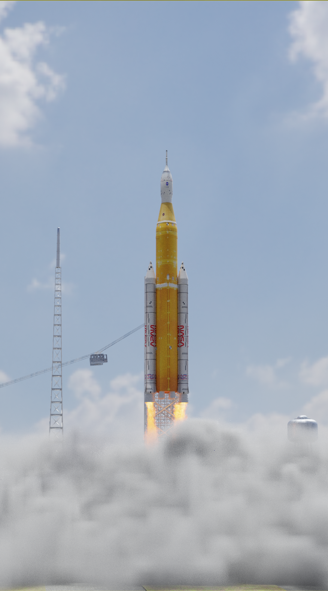
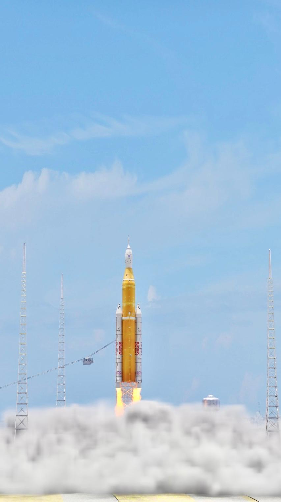
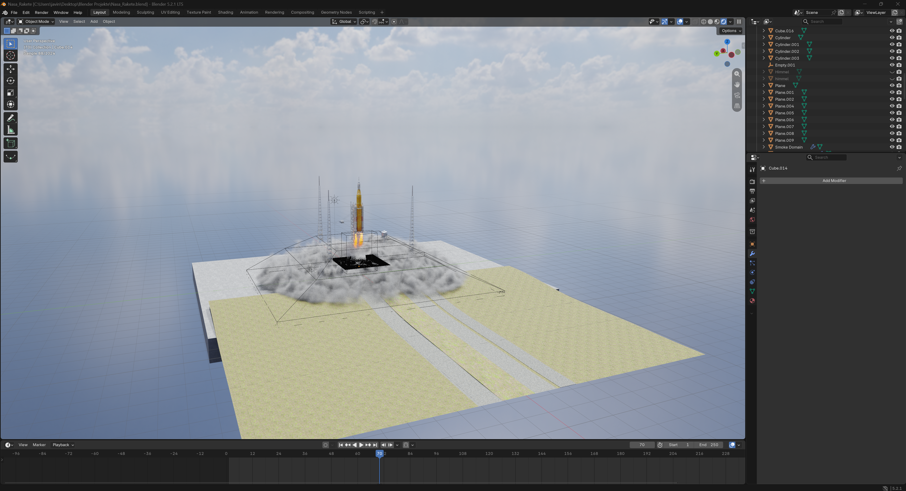

# Artemis II Launch

I modeled the launch of the artemis II reockt in blender 

 
  
Final render of the Artemis II rocket launch, created with Blender Cycles.

# About

This project recreates the launch of the Artemis II mission modeled in blender

# Technical Information

Modeling, simulation and rendering	 was made in Blender (Cycles).
The Web showcase was made with Three.js
 
